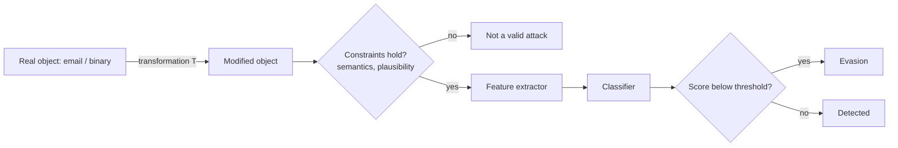

# Why Security ML Is Different

Image classifiers face adversarial examples in research; security classifiers face them **in production, every day**, from adversaries paid to evade them. Malware detectors, phishing filters, spam filters, fraud models and network intrusion detectors are all ML systems with motivated attackers.

The difference is not only that attackers exist. It is that they iterate. A spam campaign that gets filtered is rewritten by the next morning. A malware family that gets detected is repacked. The model's test set is, in effect, written by its opponent, and the opponent sees the model's decisions (delivered or not, blocked or not) and adapts.

## Differences from computer vision

| Aspect | Vision | Security |
|---|---|---|
| Attacker | hypothetical | real, adaptive, economically motivated |
| Input constraints | pixel changes within a norm | must keep functionality (malware must still run, phish must still deceive) |
| Data distribution | relatively stable | drifts constantly (new families, campaigns) |
| Labels | cheap | expensive, delayed, noisy |
| Cost of errors | symmetric-ish | false negatives = breach; false positives = alert fatigue |

Base rates deserve their own note. In many security settings the positive class is rare: a tiny fraction of emails are phishing, a tiny fraction of executables on a fleet are malicious. A detector with a 1% false-positive rate applied to a million benign events produces ten thousand false alarms. Precision at realistic base rates, not accuracy on a balanced dataset, decides whether a model is usable.

## The problem-space vs feature-space gap

Attacks computed on feature vectors (e.g. "flip feature 1234") may not correspond to any real, working binary. Pierazzi et al. (IEEE S&P 2020) formalised **problem-space attacks**: transformations on real objects (binaries, apps, emails) that preserve semantics and plausibility while changing features. That is the attack model this book uses.

Their formalisation lists constraints a realistic attack must satisfy:

| Constraint | Meaning | Example |
|---|---|---|
| Available transformations | only edits the attacker can actually make | add an import, not "set entropy to 3.2" |
| Preserved semantics | the object still does its job | binary still runs; email still asks for credentials |
| Plausibility | the object does not look absurd to a human or pre-filter | no 50 MB of random padding in an invoice email |
| Robustness to pre-processing | survives normalisation the defender applies | homoglyphs removed by NFKC normalisation are no attack |
| Side-effect features | edits change other features too | adding a section changes header sizes |

A defender can use the same list in reverse. Every constraint the attacker must satisfy is a place to put a check. If semantics must be preserved, measure semantics (behaviour, landing page, requested action). If plausibility matters, flag implausible objects.



## Measuring honestly

Two habits fix most inflated results in this field. First, split data by **time**, because the deployed model always predicts the future. Second, test with the **constraints checked**: an "evasion" that breaks the sample is not an evasion. Both are checks made by code, not judgement. Chapter 4 goes deeper on evaluation.

## Worked example

> **Execution status:** executed for this book (Python 3, NumPy, scikit-learn); the F1 values quoted were observed. The extensions at the end were not executed.

Show, with synthetic data, how a random split overstates performance when the data drifts. Everything runs locally with NumPy and scikit-learn; no real malware is involved.

```python
# drift_split.py   (pip install numpy scikit-learn)
import numpy as np
from sklearn.ensemble import RandomForestClassifier
from sklearn.metrics import f1_score
from sklearn.model_selection import train_test_split

rng = np.random.default_rng(0)
X, y, month = [], [], []
for m in range(12):
    n = 500
    benign = rng.normal(0, 1, (n, 24))
    shift = np.zeros(24); shift[[m, m + 12]] = 4.0   # each month the "family" uses new traits
    bad = rng.normal(0, 1, (n // 10, 24)) + shift
    X += [benign, bad]; y += [0]*n + [1]*(n // 10); month += [m]*(n + n // 10)
X, y, month = np.vstack(X), np.array(y), np.array(month)

def fit_eval(tr, te):
    clf = RandomForestClassifier(n_estimators=200, random_state=0).fit(X[tr], y[tr])
    return f1_score(y[te], clf.predict(X[te]))

idx = np.arange(len(y))
tr, te = train_test_split(idx, test_size=0.5, random_state=0, stratify=y)
print("random split F1  :", round(fit_eval(tr, te), 3))
print("temporal split F1:", round(fit_eval(month < 6, month >= 6), 3))
```

Run `python drift_split.py`. Expected output with this seed is roughly `random split F1 : 0.94` and `temporal split F1: 0.01`. The random split looks excellent because every month's traits appear in training. The temporal split (train on months 0–5, test on 6–11) collapses because the later months use traits the model never saw. Library versions can shift the numbers slightly; the gap is the result.

Now extend it: print F1 for each test month separately and plot it. You will see the decay that Chapter 4 summarises with the AUT metric. Finally, change the class ratio to 1:100 and watch precision fall even when recall holds. That is the base-rate effect in miniature.

## Common pitfalls

- **Random splits on time-ordered data.** They leak the future into training.
- **Balanced test sets.** Report precision at the class ratio you expect in production.
- **Feature-space "attacks" reported as real evasions.** Without a valid object, they say little about deployment risk.
- **Treating the model as the whole system.** Pre-filters, reputation and human review change what an attacker must beat.
- **One headline number.** Report per-period performance, false-positive rate at the operating threshold, and robustness per transformation.

## Exercises

1. Train a simple classifier on the EMBER feature set and report accuracy on a time-split test set.
2. List three transformations of a Windows PE file that preserve behaviour but change static features.
3. Explain why a 99.9% accuracy claim on a random split may be meaningless.

## Further reading

- Pierazzi et al., "Intriguing Properties of Adversarial ML Attacks in the Problem Space", IEEE S&P 2020
- Anderson & Roth, "EMBER: An Open Dataset for Training Static PE Malware Machine Learning Models", arXiv:1804.04637, <https://github.com/elastic/ember>
- Arp et al., "Dos and Don'ts of Machine Learning in Computer Security", USENIX Security 2022
- Axelsson, "The Base-Rate Fallacy and the Difficulty of Intrusion Detection", ACM TISSEC 2000
