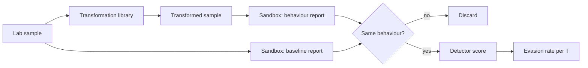

# Evading Static Malware Detectors

This chapter describes evasion techniques studied in published research so defenders can test and harden detectors. Experiments should use benign "malware-like" samples or lab-only samples, in isolated environments. The worked example deliberately uses synthetic byte strings, not executables: the mechanics of the weakness are the same, and nothing produced can run.

Static detectors decide from the file alone, without executing it. They are fast and run everywhere, which is why they are the first line on endpoints and mail gateways. Their weakness is that the attacker controls the file. Anything the detector measures that the attacker can change cheaply, without changing what the program does, is an evasion lever.

## Transformations studied in research

| Transformation | Effect on features |
|---|---|
| Appending bytes (overlay) | changes byte histograms, end-of-file content; ignored by the loader |
| Adding sections / imports | changes header and import features |
| Section renaming, padding | changes header strings and sizes |
| Packing / re-packing | changes almost everything static; packers themselves may be flagged |
| Injecting benign content (strings from goodware) | shifts token-based features |

Kolosnjaji et al. (2018) showed that appending optimised bytes could evade the MalConv byte-level network. The Machine Learning Security Evasion Competitions (2019–2021) showed participants evading several ML detectors while preserving functionality.

The common thread is **additive, semantics-free change**. Almost every effective transformation adds something the program never uses. That observation drives the strongest defences in Chapter 5.

## Why byte-level end-to-end models are fragile

Models like MalConv see raw bytes and can learn spurious signals (e.g. header fields, padding). Appended data that the loader ignores still influences the model.

Feature-based models such as the EMBER LightGBM baseline are not immune. They include byte histograms and byte-entropy histograms computed over the whole file, so appended data shifts those features too. The difference is degree: a model whose decision rests mainly on imports and header semantics moves less.

## Testing your detector

```
for each sample in a held-out malicious set (lab use):
    for each transformation T in library:
        s' = T(sample)
        assert functionality(s') == functionality(sample)   # sandbox behaviour comparison
        record score(s') vs score(sample)
report: evasion rate per T at the production threshold
```

The functionality check is mandatory. Without it you measure broken samples.



In practice "same behaviour" means comparing sandbox reports on stable signals: processes created, files written, registry keys touched, network destinations contacted. Exact equality is too strict (timestamps, random names); compare sets of normalised events and set a similarity threshold.

## Hardening

- Combine static ML with behavioural and dynamic signals.
- Ignore or separately model regions the loader ignores (overlay).
- Adversarial training with problem-space transformations.
- Monotonic features (Chapter 5).
- Treat the presence of an unusually large overlay or many unused sections as a feature in its own right.

## Worked example

> **Execution status:** the toy script was executed for this book (Python 3, NumPy, scikit-learn) and the detection rates quoted were observed. The PE-based follow-up was not executed.

This toy shows overlay sensitivity using synthetic "files": random byte strings with a 4-byte length header that marks where the "loaded" content ends. Class 1 content is drawn from a skewed byte distribution, class 0 from a different one. A byte-histogram model is trained, then attacked by appending class-0-like bytes past the declared length. The defence computes features over the declared region only.

```python
# overlay_toy.py   (pip install numpy scikit-learn)
import numpy as np
from sklearn.linear_model import LogisticRegression

rng = np.random.default_rng(1)
p0 = rng.dirichlet(np.ones(256)); p1 = rng.dirichlet(np.ones(256) * 0.3)

def make(p, n=2000):
    body = rng.choice(256, size=n, p=p).astype(np.uint8)
    return n.to_bytes(4, "little") + body.tobytes()

def hist(blob, declared_only):
    n = int.from_bytes(blob[:4], "little")
    region = blob[4:4 + n] if declared_only else blob[4:]
    h = np.bincount(np.frombuffer(region, np.uint8), minlength=256)
    return h / max(1, h.sum())

files = [make(p0) for _ in range(400)] + [make(p1) for _ in range(400)]
y = np.array([0]*400 + [1]*400)

for declared_only in (False, True):
    X = np.array([hist(f, declared_only) for f in files])
    clf = LogisticRegression(max_iter=2000).fit(X, y)
    test = [make(p1) for _ in range(200)]
    # "overlay": append class-0 bytes after the declared region
    padded = [t + rng.choice(256, 20000, p=p0).astype(np.uint8).tobytes() for t in test]
    det = lambda fs: np.mean(clf.predict(np.array([hist(f, declared_only) for f in fs])))
    print(f"declared_only={declared_only}: clean={det(test):.2f} overlay={det(padded):.2f}")
```

Run `python overlay_toy.py`. Observed output:

```
declared_only=False: clean=1.00 overlay=0.00
declared_only=True: clean=1.00 overlay=1.00
```

With whole-file features, detection falls from 1.00 to 0.00 after the overlay is appended, because the histogram is dominated by the padding. With declared-region features, both numbers stay at 1.00. The checker here is simple and deterministic: the "functionality" of a toy file is its declared region, and the attack never changes it, which you can assert with `padded[i][:len(test[i])] == test[i]` for every `i`.

The real-world counterpart is computing PE features with a parser such as LIEF or pefile and handling the overlay separately. Do that experiment only on lab-approved samples, in an isolated VM, and never distribute modified binaries.

## Common pitfalls

- **Skipping the functionality check.** Broken samples inflate evasion rates and teach nothing.
- **Testing transformations the model was trained on.** Hold out transformation families to measure real robustness.
- **Measuring at the wrong threshold.** Report evasion at the production operating point, not at 0.5.
- **Assuming feature-based models are safe from padding.** Whole-file histograms and entropy features move too.
- **Handling live malware outside a lab.** Use isolated VMs, follow your organisation's malware-handling policy, and do not share evasive variants.

## Exercises

1. Train a byte-level and a feature-based model on EMBER-like data. Measure the effect of overlay appending on each.
2. Build a functionality checker using sandbox behaviour reports.
3. Retrain with overlay-augmented samples and measure robustness and clean accuracy.

## Further reading

- Raff et al., "Malware Detection by Eating a Whole EXE" (MalConv), AAAI Workshops 2018
- Kolosnjaji et al., "Adversarial Malware Binaries: Evading Deep Learning for Malware Detection in Executables", EUSIPCO 2018
- secml-malware: <https://github.com/pralab/secml_malware>
- LIEF: <https://lief.re>; pefile: <https://github.com/erocarrera/pefile>
