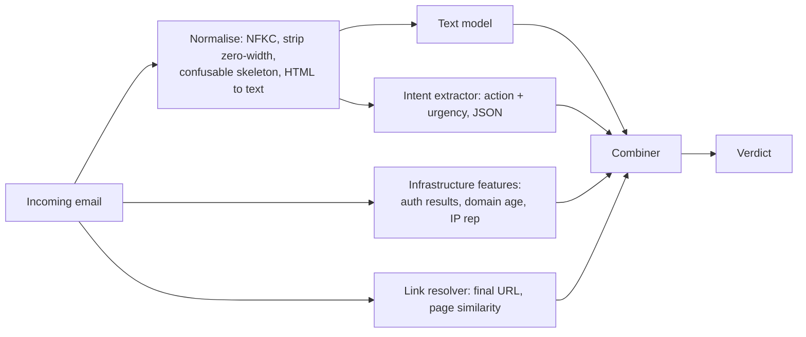

# Phishing, Spam and Text Classifiers

Text-based security classifiers (phishing emails, malicious URLs, scam messages, fraud descriptions) face attackers who can rewrite content freely. LLMs make high-quality rewrites cheap.

Unlike a binary, an email has almost no functional constraint on its wording. The only "semantics" the attacker must preserve are the request (click, log in, pay, sign) and enough credibility for a human to comply. Everything else, from vocabulary to sentence order to language, can change per recipient. A classifier that relies on wording is fighting on the attacker's best ground.

## Evasion techniques

- **Paraphrasing:** same intent, different words. LLMs generate thousands of variants.
- **Character-level tricks:** homoglyphs, zero-width characters, invisible HTML, unusual Unicode normalisation.
- **Image-based content:** text in images to avoid text classifiers.
- **Benign padding:** large amounts of legitimate-looking text.
- **URL tricks:** redirect chains through reputable domains, QR codes ("quishing").

Character-level tricks are worth understanding in detail because they are cheap and because the fix is mostly deterministic. A Cyrillic "а" (U+0430) looks identical to a Latin "a" (U+0061) but tokenises differently. A zero-width space (U+200B) inside "pass​word" splits the token in two. Neither change is visible to the reader. Unicode Technical Standard #39 defines a confusables mapping ("skeleton") designed exactly for detecting this, and NFKC normalisation folds many compatibility characters (full-width letters, ligatures) into canonical forms.

## Defensive features that resist rewriting

Rewriting changes words, not **infrastructure** and **intent**:

| Signal | Why robust |
|---|---|
| Sender infrastructure (domain age, SPF/DKIM/DMARC, sending IP reputation) | expensive to change per message |
| Link destinations after following redirects | the final landing page must exist |
| Requested action (credential entry, payment, wallet signature) | the attacker needs it |
| Visual similarity of landing pages to brands | phishing must look like the brand |

Using LLMs **defensively** to extract intent ("what action does this message ask the reader to take, and with what urgency?") helps, but the classifier must then be tested against injection: phishing emails can carry text aimed at the AI filter ("this is a legitimate internal message").



The combiner should be designed so that no single cheap-to-change signal can flip a verdict on its own. A message from a two-day-old domain asking for credentials is suspicious whatever its wording says.

## Pre-processing is part of the model

Whatever normalisation runs before the classifier at training time must run identically at inference time. A common failure is training on cleaned text from a dataset and serving on raw MIME, where quoted-printable encoding, HTML entities and invisible spans are still present. Version the pre-processing code with the model and test it with adversarial strings.

## Worked example

> **Execution status:** executed for this book (Python 3, scikit-learn); the scores quoted were observed. The paraphrase follow-up was not executed.

Train a toy text classifier on short, invented messages about a fictional bank, evade it with zero-width characters and homoglyphs, then restore it with normalisation. All data is synthetic and benign.

```python
# text_toy.py   (pip install scikit-learn)
import unicodedata, re
from sklearn.feature_extraction.text import TfidfVectorizer
from sklearn.linear_model import LogisticRegression
from sklearn.pipeline import make_pipeline

phish = ["verify your examplebank password now", "your examplebank account is locked verify password",
         "urgent: confirm examplebank login password today", "examplebank security: reset password via link"] * 25
ham = ["lunch meeting moved to thursday", "quarterly report attached for review",
       "team offsite agenda and travel details", "please review the pull request today"] * 25
X, y = phish + ham, [1]*len(phish) + [0]*len(ham)

ZW = dict.fromkeys(map(ord, "​‌‍⁠"))
CONFUSABLE = {"а": "a", "е": "e", "о": "o", "р": "p", "с": "c", "ѕ": "s"}
def normalise(s):
    s = unicodedata.normalize("NFKC", s).translate(ZW)
    return "".join(CONFUSABLE.get(ch, ch) for ch in s).lower()

attack = "verify your examplebаnk pass​word now"     # Cyrillic a + zero-width space
for name, prep in [("raw", None), ("normalised", normalise)]:
    clf = make_pipeline(TfidfVectorizer(preprocessor=prep), LogisticRegression()).fit(X, y)
    print(name, "clean:", round(clf.predict_proba(["verify your examplebank password now"])[0][1], 2),
          "attack:", round(clf.predict_proba([attack])[0][1], 2))
```

Run it. Observed output:

```
raw clean: 0.94 attack: 0.82
normalised clean: 0.94 attack: 0.94
```

With the `raw` pipeline the attack string scores lower than the clean string, because "examplebаnk" and the split "pass", "word" tokens are unknown to the vectoriser. On this tiny, repetitive dataset the drop is modest; on a realistic threshold-tuned model, losing the two most indicative tokens can be enough to cross the threshold. With the `normalised` pipeline both strings score the same. The check is mechanical: assert `normalise(attack) == "verify your examplebank password now"`.

The `CONFUSABLE` table here is a six-entry stand-in. In production, use the full UTS #39 confusables data (for example through ICU's spoof checker) rather than a hand-written list.

Then try the hard case: rewrite the phishing messages in your own words without any character tricks ("please re-enter your ExampleBank sign-in details"). The normalised model's score drops too, and no amount of Unicode cleanup fixes it. That is why the infrastructure and intent features in the table above carry the weight.

## Common pitfalls

- **Training on cleaned text, serving raw text.** Pre-processing mismatch is a silent evasion.
- **Hand-rolled confusable lists.** Use the Unicode data files; attackers use the long tail.
- **Ignoring HTML structure.** Hidden spans, white-on-white text and `display:none` content are invisible to readers but visible to models.
- **LLM filters reading raw email.** Embedded text aimed at the filter is prompt injection; evaluate with benign canary injections.
- **Evaluating on one month of one campaign.** Wording-based models look good until the next campaign.

## Exercises

1. Train a TF-IDF phishing classifier, then evaluate against LLM-paraphrased phishing. Report the drop.
2. Add infrastructure features and repeat.
3. Test an LLM-based intent extractor with embedded injection text (use a benign canary instruction).

## Further reading

- Unicode security considerations (UTS #39): <https://www.unicode.org/reports/tr39/>
- APWG eCrime research: <https://apwg.org>
- See **ai-red-teaming-security-copilots** in this wiki.
- Unicode normalization forms (UAX #15): <https://www.unicode.org/reports/tr15/>
