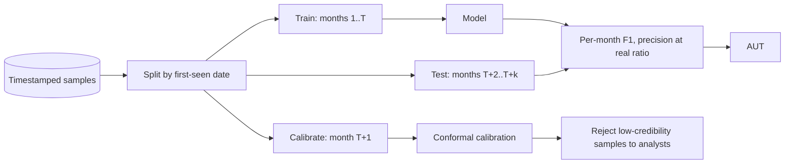

# Concept Drift and Honest Evaluation

Security data changes constantly. A model evaluated on a random split looks great and then decays in production.

Drift in security has several sources at once. Attackers change tools and campaigns. Benign software changes too: new compilers, new frameworks, new installers that look unusual to an old model. Labelling changes as vendors update their verdicts weeks after first sighting. A model trained once and left alone is measuring a world that no longer exists.

## Common evaluation mistakes

From Arp et al. (USENIX Security 2022) and Pendlebury et al. (TESSERACT, USENIX Security 2019):

| Mistake | Effect |
|---|---|
| Random train/test split | future samples in training → inflated results |
| Unrealistic class ratio | malware:goodware 50/50 vs real-world rarity → misleading precision |
| Sampling bias | datasets from one source, one time period |
| Label noise | AV-vendor consensus labels are noisy and delayed |
| Spurious correlations | model learns dataset artefacts (compiler, timestamp) |

TESSERACT names two constraints that rule out most of these. **Temporal training consistency**: every training sample must be older than every test sample. **Temporal goodware/malware windows consistency**: in each test period, benign and malicious samples must come from the same time window, otherwise the model can learn "newer means malicious". A third, **realistic malware-to-goodware ratio** in testing, addresses the base-rate problem from Chapter 1.

## Temporal evaluation

Train on data up to time T, test on T+1…T+k months, and plot performance over time. TESSERACT proposed metrics like AUT (area under time) to summarise decay.

AUT is the area under the per-period performance curve, computed with the trapezoidal rule and normalised to lie between 0 and 1. For N test periods with scores f(1)…f(N):

```
AUT = 1/(N-1) * sum_{k=1}^{N-1} (f(k) + f(k+1)) / 2
```

A model that keeps an F1 of 0.9 for a year has AUT near 0.9. A model that starts at 0.95 and collapses after two months has a much lower AUT, even though its first-month number is higher. That is the property you want from a summary metric when choosing between models that will be deployed for months.



## Handling drift in production

- Monitor score distributions and feature statistics.
- Retrain on a schedule plus on drift triggers.
- Use **conformal prediction** or uncertainty estimates to route low-confidence samples to analysts (Transcend, Jordaney et al. USENIX Security 2017).
- Keep a fresh, labelled hold-out stream (analyst-verified).

Conformal evaluation, as used in Transcend, asks for each new sample: "how unusual is this sample's fit to its predicted class, compared with samples of that class we calibrated on?" The answer is a p-value. A low p-value means the model is making a prediction on something unlike what it has seen, which is exactly what drifted samples look like. Rejecting those samples to an analyst queue trades analyst workload for error reduction, and the trade is tunable with one threshold.

## Worked example

> **Execution status:** executed for this book (Python 3, NumPy, scikit-learn); the output shown was observed. Exact numbers can vary slightly across library versions.

Synthetic drift: each month, the malicious class's old traits fade and a new trait appears. Train on months 0–3, calibrate on month 4, test on months 5–11.

```python
# aut_conformal.py   (pip install numpy scikit-learn)
import numpy as np
from sklearn.ensemble import RandomForestClassifier
from sklearn.metrics import f1_score

rng = np.random.default_rng(0)
def month_data(m, n=500):
    benign = rng.normal(0, 1, (n, 24))
    shift = np.zeros(24); shift[:4] = 3.0 - 0.25 * m   # old traits fade
    shift[4 + m] = 3.0                                    # a new trait each month
    bad = rng.normal(0, 1, (n // 10, 24)) + shift
    return np.vstack([benign, bad]), np.array([0]*n + [1]*(n // 10))

data = [month_data(m) for m in range(12)]
Xtr = np.vstack([d[0] for d in data[:4]]); ytr = np.concatenate([d[1] for d in data[:4]])
Xcal, ycal = data[4]                       # calibration month, never used for training
clf = RandomForestClassifier(n_estimators=200, random_state=0).fit(Xtr, ytr)

# 1. per-month F1 and AUT (TESSERACT: trapezoidal area, normalised to [0, 1])
f1s = [f1_score(y, clf.predict(X)) for X, y in data[5:]]
aut = sum((a + b) / 2 for a, b in zip(f1s, f1s[1:])) / (len(f1s) - 1)
print("monthly F1:", [round(f, 2) for f in f1s])
print("AUT(F1):", round(aut, 3))

# 2. conformal rejection: nonconformity = 1 - p(true class) on calibration data
# Mondrian (class-conditional) version: compare against calibration items of the same class
cal_p = clf.predict_proba(Xcal)
cal_scores = {c: 1 - cal_p[ycal == c, c] for c in (0, 1)}
def p_value(probs):
    pred = probs.argmax(1)
    s = 1 - probs[np.arange(len(pred)), pred]
    return pred, np.array([(cal_scores[c] >= v).mean() for c, v in zip(pred, s)])

Xte = np.vstack([d[0] for d in data[5:]]); yte = np.concatenate([d[1] for d in data[5:]])
pred, pv = p_value(clf.predict_proba(Xte))
for alpha in (0.0, 0.05, 0.10):
    keep = pv > alpha
    err_kept = (pred[keep] != yte[keep]).mean()
    print(f"alpha={alpha:.2f} rejected={1-keep.mean():.1%} error_on_kept={err_kept:.2%} "
          f"malicious_missed_kept={((pred==0)&(yte==1)&keep).sum()}")
```

Observed output:

```
monthly F1: [0.75, 0.3, 0.21, 0.15, 0.0, 0.0, 0.0]
AUT(F1): 0.173
alpha=0.00 rejected=0.1% error_on_kept=7.72% malicious_missed_kept=296
alpha=0.05 rejected=6.5% error_on_kept=5.70% malicious_missed_kept=204
alpha=0.10 rejected=13.8% error_on_kept=4.28% malicious_missed_kept=141
```

Read it in two parts. The monthly F1 shows the decay a random split would have hidden: usable in the first test month, near zero by the fifth. AUT compresses that into one number (0.173) that is honest about the whole deployment period. The conformal rows show the trade-off: rejecting 13.8% of samples to analysts cuts missed malicious samples among the kept ones from 296 to 141. It does not fix the model. It tells you, per sample, when not to trust it, and the rising rejection rate is itself a retraining trigger.

The calibration month is never used for training. Reusing training data for calibration makes every sample look familiar and the p-values meaningless.

## Common pitfalls

- **Random splits on time-ordered data.** The single most common cause of inflated results.
- **Using scan date instead of first-seen date.** Re-scanned old samples then appear "new" and leak.
- **Calibrating on training data.** Conformal p-values need a held-out calibration set.
- **Treating rejection as free.** Every rejected sample costs analyst time; report rejection rate next to error rate.
- **Labels from a single snapshot.** Vendor verdicts change; record when labels were collected and re-check after a delay.
- **Ignoring benign drift.** New legitimate software triggers false positives that look like model failure.

## Exercises

1. Re-evaluate a model with a temporal split and compare with a random split.
2. Plot monthly F1 over a year and compute AUT.
3. Implement a simple conformal rejection and measure analyst workload vs error reduction.

## Further reading

- Pendlebury et al., "TESSERACT: Eliminating Experimental Bias in Malware Classification across Space and Time", USENIX Security 2019
- Jordaney et al., "Transcend: Detecting Concept Drift in Malware Classification Models", USENIX Security 2017
- Arp et al., USENIX Security 2022
- Barbero et al., "Transcending Transcend: Revisiting Malware Classification in the Presence of Concept Drift", IEEE S&P 2022
