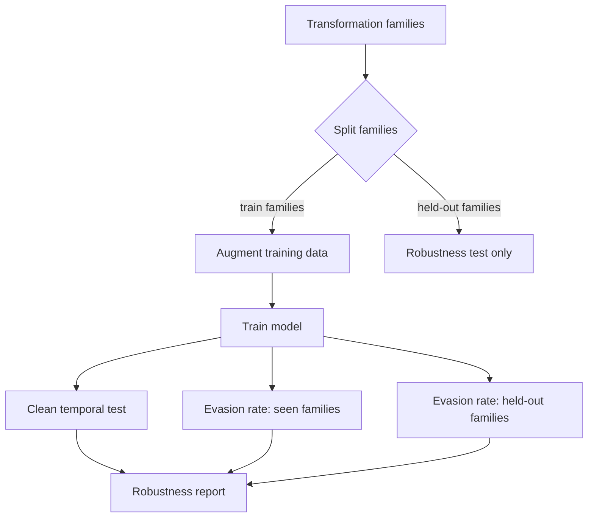

# Designing Robust Security Classifiers

Chapters 2 and 3 showed that most practical evasions are cheap, additive changes: append bytes, add imports, pad with benign text. Robust design starts by asking which changes an attacker can make cheaply and then building models whose output those changes cannot lower. This chapter covers monotonic models, feature choice, ensembles, adversarial training and how to report robustness honestly.

## Monotonic classifiers

If adding content can only **increase** maliciousness scores (monotonic in features that attackers can add), then appending benign content cannot lower the score. Incer et al. (2018) applied monotonic constraints to malware detection; gradient-boosted trees support monotonic constraints directly (e.g. LightGBM and XGBoost options).

Trade-off: some accuracy loss, large robustness gain against additive attacks. Attackers must then *remove* malicious features, which is harder while keeping functionality.

The constraint has to match the threat model. It only protects against additions to features that are constrained. If a feature can be decreased cheaply (for example, a count the attacker can lower by splitting code across files), monotonicity in that feature does not help. Incer et al. pair monotonic models with features designed so that "more of this" means "more capability", such as counts of imported API groups.

## Feature choice

- Prefer features tied to **behaviour and capability** (API calls, capa capabilities, network behaviour) over cosmetic features (strings, section names).
- Separate features the attacker controls cheaply from those that are costly to change.

A simple feature audit table helps the conversation between ML engineers and analysts:

| Feature group | Attacker cost to change | Direction attacker can move it | Use |
|---|---|---|---|
| Byte histogram (whole file) | very low | any | avoid or restrict to loaded regions |
| Section names | very low | any | low weight |
| Imported API groups | medium | mostly up (adding is easy) | monotonic +1 |
| capa capabilities | medium to high | mostly up | monotonic +1 |
| Signed by trusted publisher | high | n/a | strong benign signal, monitor for stolen certs |
| Sandbox network behaviour | high | limited | strong signal when available |

## Ensembles and diversity

Combine static, dynamic, reputation and behavioural models. An evasion that works on one rarely works on all, although transferability across similar models is real.

Diversity means different **inputs**, not just different algorithms. Three gradient-boosted models on the same byte histogram share the same blind spot. A static model, a sandbox-behaviour model and a reputation model fail differently.

## Adversarial training

Augment training data with problem-space transformations (Chapter 2). Measure robustness with transformations held out from training, otherwise you only learn to detect your own augmentations.



## Robustness reporting

Report: clean accuracy (temporal split), evasion rate per transformation family, robustness on held-out transformations, and false-positive rate at the operating threshold.

A one-page template:

| Item | Value |
|---|---|
| Training window / test window | dates |
| Clean F1 and precision at production ratio | per month, plus AUT |
| FPR at operating threshold | on a benign set from the test window |
| Evasion rate per seen transformation family | table |
| Evasion rate per held-out family | table |
| Functionality-check method | sandbox, comparison rule |
| Known gaps | features not constrained, untested families |

## Worked example

> **Execution status:** executed for this book (Python 3, NumPy, LightGBM 4.7, single-threaded); the output shown was observed.

Synthetic counts stand in for real features: five "capability" counts that are higher for the malicious class, and five "benign-looking" counts that are higher for the benign class and cheap for an attacker to inflate. The attack adds 20 to every benign-looking count.

```python
# monotone_toy.py   (pip install numpy lightgbm)
import numpy as np
import lightgbm as lgb

rng = np.random.default_rng(0)
n = 4000
# features 0-4: "capability" counts (attacker needs them); 5-9: "benign-looking" counts (cheap to add)
y = rng.integers(0, 2, n)
cap = rng.poisson(1 + 3 * y[:, None], (n, 5))
benign = rng.poisson(6 - 4 * y[:, None], (n, 5))
X = np.hstack([cap, benign]).astype(float)

def train(constraints):
    params = {"objective": "binary", "verbose": -1, "seed": 0, "num_threads": 1}
    if constraints:
        params["monotone_constraints"] = [1] * 10   # adding any feature can only raise the score
    return lgb.train(params, lgb.Dataset(X, y), num_boost_round=200)

Xm = X[y == 1][:500]
for name, c in [("unconstrained", False), ("monotone", True)]:
    m = train(c)
    padded = Xm.copy(); padded[:, 5:] += 20          # additive attack: pad with benign-looking content
    det = lambda A: (m.predict(A) > 0.5).mean()
    acc = ((m.predict(X) > 0.5) == y).mean()
    print(f"{name:13s} train_acc={acc:.3f} detect_clean={det(Xm):.2f} detect_padded={det(padded):.2f}")
```

Observed output:

```
unconstrained train_acc=1.000 detect_clean=1.00 detect_padded=0.04
monotone      train_acc=0.994 detect_clean=0.99 detect_padded=0.99
```

The unconstrained model learned that benign-looking content lowers the score, so padding drops detection from 1.00 to 0.04. The monotone model was not allowed to learn that direction. It gives up a little accuracy (0.994 versus 1.000, measured on training data here for brevity; use a temporal test set in real work) and keeps detection at 0.99 under the attack. The verdict comes from re-scoring the padded vectors, not from inspecting the model.

The toy is generous to the defender in one way: the attack is purely additive by construction. In real data, check that each constrained feature really can only move upward under the transformations you care about.

## Common pitfalls

- **Constraining features the attacker can decrease.** Monotonicity then gives false confidence.
- **Measuring robustness with the training transformations.** Always keep held-out families.
- **Ensembles of the same inputs.** Diversity of signal sources matters more than diversity of algorithms.
- **Ignoring false positives after hardening.** A robust model that flags every installer will be switched off.
- **Reporting robustness without the threat model.** State which changes were considered and which were not.

## Exercises

1. Train LightGBM with monotonic constraints on additive features and compare evasion rates.
2. Separate features into "cheap to change" and "costly to change" and train on each set.
3. Write a robustness report for one model using the template above.

## Further reading

- Incer et al., "Adversarially Robust Malware Detection Using Monotonic Classification", IWSPA 2018
- LightGBM monotonic constraints: <https://lightgbm.readthedocs.io>
- capa: <https://github.com/mandiant/capa>
- XGBoost monotonic constraints tutorial: <https://xgboost.readthedocs.io/en/stable/tutorials/monotonic.html>
