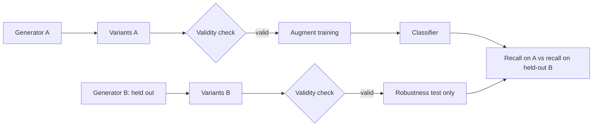

# LLMs as Attackers and Defenders of Classifiers

Large language models change the economics on both sides of the classifier. For attackers, variation becomes nearly free: a thousand distinct rewrites of a scam message, or a hundred functionally equivalent versions of a script, cost minutes. For defenders, the same capability produces training variants, explanations and intent features. This chapter looks at both sides and at the special case where the LLM is itself the classifier.

## LLMs on the attack side

- Paraphrasing phishing and scam text at scale.
- Generating functionally equivalent code variants (for script-based malware like PowerShell or JavaScript), which challenges signature and ML detection.
- Automating evasion search: propose a transformation, query the detector (if accessible), iterate.

Defensive implication: assume attackers can generate many diverse variants cheaply. Detection must rely on features variants cannot avoid.

The evasion-search loop is the same "propose and check" loop this wiki recommends for defenders, run in reverse. The attacker's checker is the detector's verdict plus a functionality test. That symmetry is useful: anything that makes the detector's verdict less available (no public scanning oracle, rate limits, delayed verdicts) slows the loop down.

## LLMs on the defence side

- **Explaining detections** to analysts.
- **Feature extraction** of intent from text (Chapter 3).
- **Generating training variants** for adversarial training (paraphrases of phishing, equivalent script rewrites).
- **Triage** of low-confidence samples (with the injection caveats from **ai-red-teaming-security-copilots**).

Every one of these needs a deterministic check. Generated training variants must be validated (does the phishing variant still request the action? does the rewritten script still behave the same in a sandbox?) or you train on noise. Extracted intent must be schema-validated. Explanations must cite features that exist. The model proposes; the checker decides.

| Defensive use | Model output | Checker |
|---|---|---|
| Training variants (text) | paraphrased message | rule or parser confirms requested action and link survive |
| Training variants (scripts) | rewritten benign script | sandbox trace equals original's on key events |
| Intent extraction | JSON `{action, urgency}` | schema validation; spot-check against labels |
| Explanations | cited features | feature IDs exist and have the stated values |
| Triage suggestions | verdict + evidence | evidence-ID validation; human for suppressions |

## LLM-based classifiers are classifiers too

Using an LLM as a detector ("is this email phishing?") inherits all problems in this book, plus prompt injection. Evaluate it with temporal splits and adversarial variants, like any model.

Two extra issues apply. First, **version drift**: a hosted model can change behind the same name, so pin versions where possible and rerun a regression set on every change. Second, **training-data overlap**: public phishing corpora may be in pre-training data, which inflates scores on them. Evaluate on fresh, private samples from after the model's training cutoff.



## Worked example

> **Execution status:** executed for this book (Python 3, scikit-learn); the output shown was observed. Two template "generators" stand in for two different LLMs, so the run is deterministic and needs no API. Replacing them with real model calls was not executed; verify locally.

The question: does augmenting with variants from one generator make the classifier robust to variants from another? All messages concern a fictional bank and contain a placeholder instead of a real link.

```python
# paraphrase_eval.py   (pip install scikit-learn)
import random, re
from sklearn.feature_extraction.text import TfidfVectorizer
from sklearn.linear_model import LogisticRegression
from sklearn.pipeline import make_pipeline

random.seed(0)
BASE = "please {verify} your examplebank {password} at {link} {urgent}"
GEN_A = {"verify": ["verify", "confirm", "validate"], "password": ["password", "login", "credentials"],
         "urgent": ["today", "now", "immediately"]}
GEN_B = {"verify": ["re-enter", "update", "check"], "password": ["sign-in details", "passcode", "account pin"],
         "urgent": ["before noon", "within 24 hours", "asap"]}   # stands in for a different LLM
HAM = ["please read your examplebank statement at [LINK] {d}", "examplebank branch hours change {d}, see [LINK]",
       "please review your examplebank newsletter at [LINK] {d}", "examplebank app update notes {d} at [LINK]"]

def variants(gen, k):
    return [BASE.format(link="[LINK]", **{s: random.choice(v) for s, v in gen.items()}) for _ in range(k)]
def ham(k): return [random.choice(HAM).format(d=random.choice(["today", "monday", "this week"])) for _ in range(k)]

def valid(msg):   # deterministic intent check: still asks for a credential action and carries the link
    return "[LINK]" in msg and bool(re.search(r"examplebank", msg))

seed_phish = [BASE.format(verify="verify", password="password", link="[LINK]", urgent="now")] * 50
test_B = [v for v in variants(GEN_B, 300) if valid(v)]
for name, extra in [("baseline", []), ("augmented_with_A", variants(GEN_A, 300))]:
    X = seed_phish + extra + ham(350); y = [1] * (50 + len(extra)) + [0] * 350
    clf = make_pipeline(TfidfVectorizer(ngram_range=(1, 2)), LogisticRegression(max_iter=1000)).fit(X, y)
    rA = clf.predict([v for v in variants(GEN_A, 300) if valid(v)]).mean()
    rB = clf.predict(test_B).mean()
    print(f"{name:17s} recall_on_A={rA:.2f} recall_on_heldout_B={rB:.2f}")
```

Observed output:

```
baseline          recall_on_A=0.25 recall_on_heldout_B=0.00
augmented_with_A  recall_on_A=1.00 recall_on_heldout_B=0.42
```

Augmenting with generator A's variants makes the model perfect on generator A, which is what a careless evaluation would report. On the held-out generator B the recall is only 0.42. Robustness measured with the same generator used for training is mostly memorisation of that generator's vocabulary. The `valid()` function is the deterministic check that every variant still carries the fake bank name and the link placeholder; in a real pipeline it would be a stronger parser plus a human spot-check.

To use real LLMs, replace `variants()` with calls to two different model families, keep `valid()` (or strengthen it), and keep the held-out family out of training entirely.

## Common pitfalls

- **Testing on variants from the training generator.** Hold out a generator, as you hold out transformation families.
- **Skipping validity checks on generated data.** Some variants drop the malicious request and become mislabelled benign text.
- **Generating real phishing for real brands.** Use fictional brands and placeholder links in research corpora.
- **Unpinned hosted models as detectors.** Silent upgrades change verdicts; track a regression set.
- **LLM detectors reading raw attacker text.** Test with benign canary injections and validate outputs.

## Exercises

1. Generate 500 paraphrased phishing variants and use them for adversarial training. Measure robustness on variants from a different model.
2. Evaluate an LLM-as-classifier on a temporal phishing dataset and against injection-bearing samples (benign canary instructions only).
3. Generate equivalent PowerShell variants of a benign script and test a script classifier's stability.

## Further reading

- Arp et al., USENIX Security 2022
- MITRE ATLAS: <https://atlas.mitre.org>
- See **ai-reverse-engineering-pipelines** in this wiki.
- Pierazzi et al., "Intriguing Properties of Adversarial ML Attacks in the Problem Space", IEEE S&P 2020
